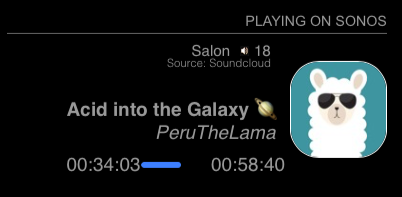

# MMM-Sonos

<p>
<a href="https://github.com/jishi/node-sonos-http-api"></a>
<a href="http://choosealicense.com/licenses/mit"></a>
</p>

A [MagicMirror²](https://github.com/MagicMirrorOrg/MagicMirror) module that shows what is playing on your Sonos speakers: song, artist, album art, source, room, volume and a live progress bar. It updates in real time and hides itself when nothing plays.

Based on [Vaggan's](https://github.com/Vaggan) [MagicMirror-SonosModule](https://github.com/Vaggan/MagicMirror-SonosModule), [CFenner's](https://github.com/CFenner) [MagicMirror-Sonos-Module](https://github.com/CFenner/MagicMirror-Sonos-Module) and [Snille's](https://github.com/Snille) changes.

When starting the Mirror:


Module on the Right side of the Mirror:



## Usage

_Prerequisites_

- MagicMirror² running on Node.js 18 or newer
- [node-sonos-http-api](https://github.com/jishi/node-sonos-http-api) installed and [running at startup](https://docs.magicmirror.builders/configuration/autostart.html) (e.g. with pm2)

### Installation

In your terminal, go to your MagicMirror's Module folder:

```
cd ~/MagicMirror/modules
```

Clone this repository:

```
git clone https://github.com/Perhan35/MMM-Sonos.git
```

No `npm install` is needed: the module has no dependencies.

Add some [config entries](#configuration) to your config.js file. After that the content will be added to your mirror.

### Configuration

Add this to the `modules` list of your `config.js`:

```js
{
	module: 'MMM-Sonos',
	header: 'Playing on SONOS',
	position: 'top_center', // any region, best results in center regions
	config: {
		// See 'Configuration options' below.
	}
}
```

Configuration options:

| Option | Description |
|---|---|
|`showAlbumArt`|Show the album art.<br><br>**Default value:** `true`|
|`showRoomName`|Show the zone name and volume.<br><br>**Default value:** `true`|
|`preRoomText`|Text to be displayed before the zone name. HTML is allowed (e.g. an icon).<br><br>**Default value:** `Zone: `|
|`preArtistText`|Text to be displayed before the artist name.<br><br>**Default value:** `Artist: `|
|`preTrackText`|Text to be displayed before the track name.<br><br>**Default value:** `Track: `|
|`preTypeText`|Text to be displayed before the source name.<br><br>**Default value:** `Source: `|
|`animationSpeed`|Length of the fade animation in ms (used when the song changes).<br><br>**Default value:** `1000`|
|`updateInterval`|How often (in minutes) the module asks the Sonos API, as a fallback. With [real-time updates](#real-time-updates) it rarely matters.<br><br>**Default value:** `0.5`|
|`useEvents`|[Real-time updates](#real-time-updates) from the API's `/events` stream.<br><br>**Default value:** `true`|
|`apiBase`|http link to the SONOS API.<br><br>**Default value:** `http://localhost`|
|`apiPort`|SONOS API port.<br><br>**Default value:** `5005`|
|`apiEndpoint`|Link to the "zones" information on the SONOS API.<br><br>**Default value:** `zones`|
|`exclude`|Zone names to exclude, e.g. `["Secret-Room", "Greenhouse"]`.<br><br>**Default value:** `[]`|
|`sourceArt`|Picture for a source instead of the default icon: an image URL or [Font Awesome](https://fontawesome.com/search?ic=free) classes. Sources: `TV`, `Line-in`, `Bluetooth`, `Radio`, `Spotify`, `NAS`, `Apple Music`, `Soundcloud`, `Mixcloud`, `AirPlay`. Example below.<br><br>**Default value:** `{}`|
|`speakerUrls`|Optional. Only needed if some album art is missing. The API usually gives the full album art address; when it only gives a path, the module uses this speaker address. Keys are room names (or speaker UUIDs), e.g. `{ "Living Room": "http://192.168.1.20:1400" }`.<br><br>**Default value:** `{}`|
|`apiAlbumArt`|Fallback address for album art paths when the room is not in `speakerUrls`.<br><br>**Default value:** `http://localhost`|
|`proxyAlbumArt`|The mirror fetches the album art and serves it to the browser. Needed when the screen showing the mirror cannot reach the speakers (other network/VLAN, no internet) or opens the mirror over https. Only images given by the Sonos API, on a known speaker, or set in `sourceArt` are fetched. Set `false` to load images straight from the speakers.<br><br>**Default value:** `true`|

What the module does:

- It only shows zones that are playing, and hides itself when nothing plays.
- If the Sonos API stops answering (3 failed requests in a row), it hides the last song instead of leaving it on screen.
- The progress bar moves every second in the browser, without asking the API more often.
- Long titles scroll.
- The volume icon shows when a speaker or group is muted (or at 0).
- TV, Line-in and Bluetooth show an icon (no album art for these sources).

#### Your own picture for a source

By default TV shows a TV icon and Line-in a plug icon. To show your own picture (e.g. the turntable or DJ controller plugged into the line-in):

```js
config: {
	sourceArt: {
		'Line-in': 'https://www.pioneerdj.com/-/media/pioneerdj/images/features/controller/ddj-flx4/ddj-flx4_hotspot_top_pc.png',
		TV: 'fa-solid fa-film' // a Font Awesome icon also works
	}
}
```

### Real-time updates

The module keeps a connection open to node-sonos-http-api's `/events` stream: song, play/pause, volume and mute changes show up right away. Nothing to set up. It reconnects by itself if the API restarts.

If your node-sonos-http-api is too old to have `/events`, the log says `Sonos events: cannot connect ... (HTTP 404)` and the module falls back to asking every `updateInterval`. Update node-sonos-http-api, or use the webhook below.

<details>
<summary>Older way: webhook</summary>

node-sonos-http-api can also POST every event to the mirror. Add this to its `settings.json`, then restart it:

```json
{
  "webhook": "http://localhost:8080/MMM-Sonos/webhook"
}
```

- `8080` is MagicMirror's default port: use yours if you changed it.
- If node-sonos-http-api runs on **another machine** than the mirror, replace `localhost` with the mirror's address and add the API machine's IP to `ipWhitelist` in MagicMirror's `config.js`.
- node-sonos-http-api supports **only one** webhook URL.

With `/events` working, you do not need this: you can remove the `webhook` line from `settings.json`.

</details>

### Custom-CSS

Here is my CSS settings for the module that I have added to my custom.css to give it the exta special look. :)

```css
/* Sonos --------------------------------------------*/
.sonos ul .type {
	font-size: 12px;
	padding: 0px 0px;
	line-height: 12px;
	width: 260px;
}
.sonos ul .room {
	font-size: 16px;
	padding: 0px 0px;
	line-height: 16px;
	width: 260px;
}
.sonos ul .song {
	padding: 0px 0px;
	position: relative;
}
.sonos ul .art img {
	height: 60px;
	width: 60px;
	border-radius: 50%;
	margin: 0px 0px;
	border: 2px solid #FFF;
}
.sonos ul .name {
	width: 200px;
	font-size: 16px;
	padding: 0px 4px;
	line-height: 16px;
}
/* scrolling long titles: same width as .name */
.sonos ul .title-wrapper.scrolling {
	width: 200px;
}
/*****************************************************/
```

## Development

Only needed to work on the module (not to use it):

```
npm install
npm test       # unit tests (node:test)
npm run lint   # ESLint
```

GitHub Actions runs both on every push and pull request.
